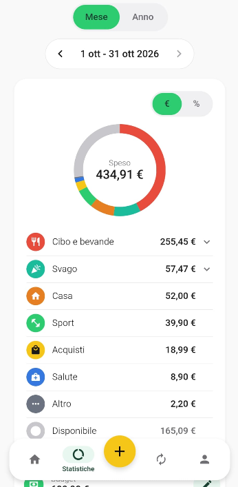

# TrackIt

Web app per gestire le finanze personali: spese, budget e abbonamenti, con un assistente AI che registra una spesa partendo da una frase scritta normalmente (es. *"ieri 12€ pizza"*).

**Prova l'app:** https://gabfum11.github.io/FinanceApp/

<p>
  
  
  
</p>
<p>
  
  
</p>


## Funzionalità

- **Spese e categorie**, con budget mensile e statistiche per mese e per anno
- **Abbonamenti** con rinnovi automatici o manuali
- **Assistente AI**: scrivi la spesa in linguaggio naturale, l'app ricava importo, data e categoria
- **Import dell'estratto conto** (xlsx, xls, csv): pulisce i nomi dei negozi, propone le categorie e riconosce i doppioni(possibilità di annullare l'importo dal profilo)
- **Valute estere** una spesa in un'altra valuta viene convertita con quella selezionata
- **Esportazione** dei dati
- Interfaccia in **italiano e inglese**, installabile sul telefono come app (PWA)

## Tecnologie

| | |
|---|---|
| **Backend** | Python, FastAPI, SQLAlchemy, Alembic, pytest |
| **Database** | PostgreSQL (Supabase) |
| **Frontend** | TypeScript, React Native, Expo, react-native-web |
| **AI** | LLM tramite API Groq |
| **Deploy** | backend su Render, frontend su GitHub Pages, server nell'UE |

## Sicurezza e privacy

- Autenticazione con JWT (access e refresh token, revoca), password con hash Argon2, accesso con Google
- Limiti al numero di richieste e header di sicurezza
- Descrizioni e budget **cifrati nel database**: chi apre il database non li legge
- All'AI non arrivano mai i nomi delle persone nei bonifici
- [Informativa sulla privacy](PRIVACY-POLICY.md)

## Struttura

```
backend/   API FastAPI, modelli del database, migrazioni e test
mobile/    frontend Expo (web e mobile con lo stesso codice)
```

## Avvio in locale

**Backend** (Python 3.10+):

```bash
cd backend
python -m venv venv
venv\Scripts\activate          # su macOS/Linux: source venv/bin/activate
pip install -r requirements.txt
alembic upgrade head
uvicorn app.main:app --reload
```

Serve un file `backend/.env` con almeno `DATABASE_URL`, `SECRET_KEY` e `CHIAVE_CIFRATURA`. Per l'assistente serve anche `GROQ_API_KEY`.

**Frontend:**

```bash
cd mobile
npm install
cp .env.example .env
npx expo start --web
```

**Test:**

```bash
cd backend
pytest
```
